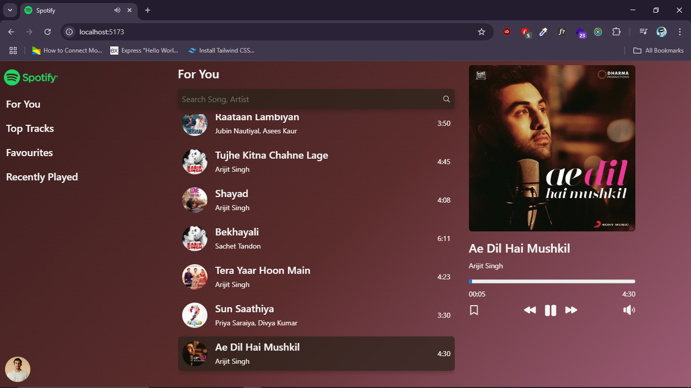

<div align="center">

# 🎵 Spotify Music Player

### A React-Based Music Streaming Interface

A modern music player inspired by Spotify, built with React, Vite, Redux Toolkit, and React Audio Player. Discover songs, explore a music library, search for tracks, and enjoy music through a clean, interactive interface.

**[🌐 Live Demo](https://spotify-music23.netlify.app/) · [📂 GitHub Repository](https://github.com/vankayalavamsi/Spotify)**

</div>

---

## 📸 Screenshots

Explore the application's interface through the screenshots included in this repository.

### Application Preview



---

## 📖 About the Project

Spotify Music Player is a web application developed to demonstrate how a modern music player interface can be built using React and related frontend technologies.

The application organizes music into a structured library, displays song information and artwork, and provides a dedicated player interface for audio playback.

It uses locally stored audio files and images, allowing the application to serve its included music collection without requiring an external music-streaming API for those assets.

The project also uses Redux Toolkit and React Redux for application state management, making it easier to share music-related state across different components.

The application is deployed on Netlify and can be accessed through the live demo.

### 🎯 Project Objectives

* Build an interactive music player using React.
* Create reusable components for the sidebar, song list, search bar, and player.
* Display songs with their associated artwork and metadata.
* Organize music data separately from the user interface.
* Manage shared application state with Redux Toolkit.
* Play locally available audio files in the browser.
* Create a foundation for additional features such as playlists, favorites, and playback controls.
* Deploy the application to a publicly accessible hosting platform.

---

## ✨ Features

The following sections describe the application's structure and intended functionality. Confirm individual interactions against the running application before treating every feature as fully implemented.

### 🎵 Music Library

* Organizes song information in a structured JSON file.
* Uses local audio files stored in the `public/` directory.
* Includes artwork for selected songs.
* Supports displaying song information through reusable React components.

### 🔎 Search

The application includes a dedicated `Searchbar.jsx` component.

This provides the interface for a song-search feature. The actual search behavior depends on the component's implementation.

### 🎧 Audio Player

The project includes a `Player.jsx` component and the `react-h5-audio-player` package.

These provide the foundation for browser-based music playback and audio controls.

The included music files can be served directly from the application's public assets.

### 🧩 Reusable Components

The application separates major interface elements into individual components.

This makes the code easier to understand, maintain, test, and extend.

### 🔄 State Management

Redux Toolkit and React Redux are included in the project.

The `songSlice.js` file provides a dedicated location for song-related Redux state, while `store.js` configures the Redux store.

### 🎨 User Interface

The project uses React Bootstrap, Bootstrap, and React Icons to support interface styling and iconography.

The exact visual layout and responsive behavior depend on the application's CSS and component implementations.

---

## 🛠️ Technologies Used

| Technology              | Purpose                                              |
| ----------------------- | ---------------------------------------------------- |
| React 19                | Building the user interface with reusable components |
| Vite 6                  | Development server and production build tooling      |
| Redux Toolkit           | Managing application state                           |
| React Redux             | Connecting React components to the Redux store       |
| Bootstrap 5             | Base styling and layout utilities                    |
| React Bootstrap         | Bootstrap components for React                       |
| React H5 Audio Player   | Audio player interface and playback controls         |
| React Icons             | Icons for interface elements                         |
| React Hot Toast         | Toast notification support                           |
| JavaScript (ES Modules) | Application logic and module imports                 |
| HTML5 Audio             | Browser audio playback capabilities                  |
| CSS                     | Application-specific styling                         |
| ESLint                  | Code quality and linting                             |
| Netlify                 | Hosting and deployment                               |

### Why These Technologies?

**React** enables the interface to be divided into reusable components.

**Vite** provides a fast development environment and builds the application for production.

**Redux Toolkit** simplifies Redux state management and helps organize shared application state.

**React H5 Audio Player** provides an audio player component that can be integrated into the React interface.

**Bootstrap and React Icons** help build consistent layouts and recognizable interface controls.

**Netlify** makes the finished frontend application accessible online.

---

## 📂 Project Structure

The repository follows a component-based React project structure.

```text
Spotify/
│
├── public/
│   ├── ABCD-2.jpg
│   ├── Ae-Dil-Hai-Mushkil.jpg
│   ├── ae-dil-hai-muskil.mp3
│   ├── apna-bana-le.mp3
│   ├── bekhayali.jpg
│   ├── bekhayali.mp3
│   ├── kesariya.mp3
│   ├── logo.png
│   ├── raataan-lambiyan.mp3
│   ├── shayad.mp3
│   ├── sun-saathiya.mp3
│   ├── tera-yaar-hoon-main.mp3
│   ├── tujhe-kitna-chahne.mp3
│   ├── tum-hi-ho.mp3
│   └── vite.svg
│
├── screenshots/
│   └── image.png
│
├── src/
│   ├── app/
│   │   ├── songSlice.js
│   │   └── store.js
│   │
│   ├── assets/
│   │   ├── react.svg
│   │   └── spotify.png
│   │
│   ├── components/
│   │   ├── Player.jsx
│   │   ├── Searchbar.jsx
│   │   ├── Sidebar.jsx
│   │   ├── Song.jsx
│   │   └── SongList.jsx
│   │
│   ├── App.jsx
│   ├── index.css
│   ├── main.jsx
│   └── songs.json
│
├── .gitignore
├── eslint.config.js
├── image.png
├── index.html
├── package.json
├── package-lock.json
├── README.md
└── vite.config.js
```

### Explanation of Important Files

#### `src/App.jsx`

The main application component.

It typically brings together the application's major interface sections and determines how the components are arranged.

#### `src/main.jsx`

The frontend entry point.

It initializes the React application and renders the root component into the HTML document. It is also a common place to configure the Redux provider.

#### `src/index.css`

Contains application-wide CSS rules, such as base typography, layout defaults, and global styling.

#### `src/songs.json`

Stores structured song information separately from the interface.

Depending on the fields defined in this file, song records can contain titles, artists, album artwork paths, audio paths, or other metadata.

#### `src/app/songSlice.js`

Defines the Redux slice responsible for song-related state.

A Redux slice commonly contains an initial state and reducers that describe how that state changes.

The exact state fields and reducer actions depend on the implementation.

#### `src/app/store.js`

Configures the Redux store and registers the application's Redux slices.

The store provides a shared location for state that needs to be accessed by multiple components.

#### `src/components/Sidebar.jsx`

Contains the sidebar interface.

This component can organize navigation links or other persistent navigation elements.

#### `src/components/Searchbar.jsx`

Contains the search interface.

It provides the UI location for entering a search query and can be connected to the song library.

#### `src/components/Song.jsx`

Represents an individual song or song card.

It can display song artwork, title, artist information, and controls associated with a track.

#### `src/components/SongList.jsx`

Organizes and renders a collection of songs.

It can use the song data from `songs.json` and render reusable `Song` components.

#### `src/components/Player.jsx`

Contains the music player interface.

The project dependencies include React H5 Audio Player, which can provide playback controls and audio progress information.

#### `public/`

Contains static files that Vite serves directly.

The project stores music files, artwork, and the application logo in this directory.

Files in `public/` can be referenced using root-relative paths. For example:

```jsx
const audioPath = "/tum-hi-ho.mp3";
const imagePath = "/ABCD-2.jpg";
```

The paths must match the actual filenames, including capitalization and spelling.

#### `screenshots/`

Stores screenshots used to document the application's interface in the README.

#### `package.json`

Defines the project's dependencies and development scripts.

#### `vite.config.js`

Contains the configuration for Vite and its plugins.

#### `eslint.config.js`

Defines the project's ESLint configuration for identifying potential code issues.

---

## ⚙️ Getting Started

Follow these steps to run the project on your local machine.

### Prerequisites

Install the following software:

* **Node.js:** A compatible Node.js release for the installed Vite version.
* **npm:** Usually installed alongside Node.js.
* **Git:** Required to clone the repository.
* A code editor, such as Visual Studio Code.

Verify your installation:

```bash
node --version
npm --version
git --version
```

### 1. Clone the Repository

Open a terminal and run:

```bash
git clone https://github.com/vankayalavamsi/Spotify.git
```

### 2. Navigate to the Project

```bash
cd Spotify
```

### 3. Install Dependencies

Run the following command:

```bash
npm install
```

This installs the dependencies defined in `package.json`.

Because the repository includes `package-lock.json`, npm can use the lockfile to resolve the project's dependency versions.

### 4. Start the Development Server

```bash
npm run dev
```

Vite will display a local development URL in the terminal, usually:

```text
http://localhost:5173/
```

Open the displayed URL in your browser to access the application.

### 5. Build for Production

To create an optimized production build, run:

```bash
npm run build
```

Vite generates the production files in the `dist/` directory.

### 6. Preview the Production Build

After building the project, run:

```bash
npm run preview
```

Vite starts a local server to preview the production build.

### 7. Run ESLint

To check the project for linting issues, run:

```bash
npm run lint
```

These commands are defined in the project's `package.json`.

---

## 🎼 How the Application Works

The project is organized around three main concerns: song data, the user interface, and application state.

### 1. Song Data

The `songs.json` file provides a structured source of song metadata.

The React components can read this information and use it to render the available tracks.

The `public/` directory stores the corresponding audio and image assets.

### 2. Rendering Songs

The `SongList.jsx` component is responsible for organizing a collection of songs.

A common component flow is:

```text
songs.json
    |
    v
SongList.jsx
    |
    v
Song.jsx
    |
    v
Song Cards / Track Information
```

The precise data flow depends on the component props and implementation.

### 3. Audio Playback

The `Player.jsx` component provides the location for playback functionality.

The application includes the React H5 Audio Player dependency and local MP3 files.

A typical local audio source looks like this:

```jsx
<audio controls src="/tum-hi-ho.mp3">
  Your browser does not support audio playback.
</audio>
```

This is an illustrative HTML5 audio example. The application's actual player implementation may use the installed audio-player package instead.

### 4. Redux State Management

The project contains a Redux slice and store configuration.

The general Redux data flow is:

```text
User Interaction
       |
       v
Component Dispatches Action
       |
       v
Redux Reducer Updates State
       |
       v
Store Contains Updated State
       |
       v
Connected Components Re-render
```

The exact actions and state properties are determined by `songSlice.js`.

### 5. Search

The `Searchbar.jsx` component provides the search interface.

When connected to the song collection, a search feature can filter tracks by title or artist and update the displayed results.

The actual search fields and matching behavior depend on the current implementation.

---

## 🎧 Included Music Assets

The repository contains several MP3 files and images.

### Audio Files

| File                      | Format |
| ------------------------- | ------ |
| `ae-dil-hai-muskil.mp3`   | MP3    |
| `apna-bana-le.mp3`        | MP3    |
| `bekhayali.mp3`           | MP3    |
| `kesariya.mp3`            | MP3    |
| `raataan-lambiyan.mp3`    | MP3    |
| `shayad.mp3`              | MP3    |
| `sun-saathiya.mp3`        | MP3    |
| `tera-yaar-hoon-main.mp3` | MP3    |
| `tujhe-kitna-chahne.mp3`  | MP3    |
| `tum-hi-ho.mp3`           | MP3    |

### Image Assets

The repository also includes:

* `ABCD-2.jpg`
* `Ae-Dil-Hai-Mushkil.jpg`
* `bekhayali.jpg`
* `logo.png`

These assets can be used to represent songs, albums, or the application brand.

The mapping between each image and its corresponding song should be checked in `songs.json`.

---

## 🚀 Deployment

The project is hosted on Netlify.

### Live Application

**[Open Spotify Music Player](https://spotify-music23.netlify.app/)**

### Deploy Your Own Version

To deploy an updated version of the application:

1. Push your project to GitHub.
2. Sign in to Netlify.
3. Import the GitHub repository.
4. Configure the build settings.
5. Deploy the application.

Recommended settings for a standard Vite application:

| Setting           | Value                                                   |
| ----------------- | ------------------------------------------------------- |
| Build command     | `npm run build`                                         |
| Publish directory | `dist`                                                  |
| Base directory    | Leave empty if the project root contains `package.json` |

After deployment, Netlify will provide a public URL.

If you update the source code and push changes to the connected GitHub branch, Netlify can rebuild and redeploy the application automatically when continuous deployment is enabled.

---

## 🧪 Testing Checklist

Use this checklist to verify the application before releasing changes.

* [ ] The application loads without a blank screen.
* [ ] All song cards display the expected information.
* [ ] Album artwork loads correctly.
* [ ] Search returns the expected results, if implemented.
* [ ] Selecting a song updates the appropriate player state.
* [ ] Audio playback works.
* [ ] Play and pause controls behave correctly.
* [ ] Audio progress updates during playback.
* [ ] The interface handles missing or invalid assets gracefully.
* [ ] The application works at desktop and mobile screen sizes.
* [ ] The production build completes successfully.
* [ ] The deployed Netlify version works as expected.

---

## 🔮 Future Improvements

The project can be extended with additional music-player capabilities.

### Playback

* Previous and next track controls.
* Shuffle and repeat modes.
* Volume adjustment.
* Track duration and playback progress.
* Automatic playback of the next track.

### Music Discovery

* Improved search by song title and artist.
* Genre-based categories.
* Recently played tracks.
* Favorite songs.
* Custom playlists.

### User Experience

* Responsive mobile layout.
* Loading and empty states.
* Better keyboard accessibility.
* Improved error messages.
* Persistent playback preferences.

### Advanced Features

* User authentication.
* Playlist persistence.
* A backend for music metadata.
* Cloud-hosted music assets.
* Integration with a supported music API, where permitted.

These are potential enhancements, not claims about functionality currently implemented in the repository.

---

## 🐛 Troubleshooting

### The application does not start

Install dependencies and start the development server again:

```bash
npm install
npm run dev
```

Check the terminal for dependency errors or port conflicts.

### Audio files do not play

Check that:

* The referenced file exists in `public/`.
* The audio URL uses the correct filename.
* The file is a valid audio file.
* The browser console does not report a failed request.

For example:

```jsx
const audioUrl = "/tum-hi-ho.mp3";
```

Public asset paths should begin with `/` when referencing files directly from the public directory.

### Album artwork does not display

Verify the image path and exact filename.

For example:

```jsx
const coverUrl = "/ABCD-2.jpg";
```

Filename capitalization can matter when the application is deployed on a Linux-based hosting environment.

### Changes do not appear after deployment

Run a production build locally:

```bash
npm run build
```

Then verify that the latest changes have been committed and pushed to the connected GitHub branch.

Check the Netlify deployment logs if the deployment fails.

### ESLint reports errors

Run:

```bash
npm run lint
```

Review the reported file names and line numbers, then fix the relevant issues.

---

## 🤝 Contributing

Contributions and suggestions are welcome.

To contribute:

1. Fork the repository.
2. Create a feature branch.
3. Make your changes.
4. Test the application.
5. Commit your changes.
6. Open a pull request.

Example:

```bash
git checkout -b feature/improve-player
git add .
git commit -m "Improve music player controls"
git push origin feature/improve-player
```

Keep changes focused and ensure that existing functionality continues to work.

---

## 📚 Learning Resources

* [React Documentation](https://react.dev/)
* [Vite Documentation](https://vite.dev/guide/)
* [Redux Toolkit Documentation](https://redux-toolkit.js.org/)
* [React Redux Documentation](https://react-redux.js.org/)
* [Bootstrap Documentation](https://getbootstrap.com/docs/)
* [React Bootstrap Documentation](https://react-bootstrap.github.io/)
* [React H5 Audio Player](https://github.com/lhz516/react-h5-audio-player)
* [Netlify Documentation](https://docs.netlify.com/)

---

## 👨‍💻 Project Links

| Resource          | Link                                                                |
| ----------------- | ------------------------------------------------------------------- |
| Live Application  | [spotify-music23.netlify.app](https://spotify-music23.netlify.app/) |
| GitHub Repository | [vankayalavamsi/Spotify](https://github.com/vankayalavamsi/Spotify) |

---

## 📄 License

No explicit license has been verified for this repository.

Before reusing, modifying, or redistributing the project, check the repository for a license file and confirm the rights associated with the included code, music files, artwork, and logos.

---

<div align="center">

### 🎶 Enjoy the Music!

Built with React, Vite, and a passion for music.

**If you find this project useful, consider giving the repository a star on GitHub.**

</div>
